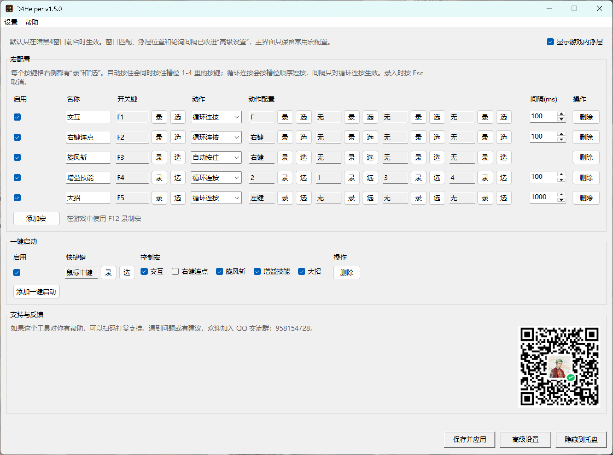
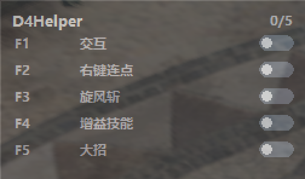

# D4Helper

D4Helper 是一个针对《暗黑破坏神 IV》的 Windows 轻量辅助工具，用来减少重复按键和长按操作带来的疲劳。

它不是通用宏编辑器，而是面向暗黑 4 的简单宏开关工具：只在配置的游戏窗口处于前台时生效，窗口失焦后会自动释放输入、停止循环并清理宏状态。

## 默认行为

- F1：切换交互，每 100ms 短按 `F`。
- F2：切换右键连点，间隔 100ms。
- F3：切换旋风斩，自动按住右键。
- F4：切换增益技能，每 100ms 依次短按 `2 -> 1 -> 3 -> 4`。
- F5：切换大招，每 1000ms 短按鼠标左键。
- 鼠标中键：一键启动或关闭交互、旋风斩、增益技能和大招。
- F10：进入或退出浮层布局模式，可直接拖动状态浮层和线路图浮层。
- F11：打开地狱蠕虫线路图选择器。
- F12：开始或结束游戏内宏录制。
- 游戏内浮层显示每个启用宏的开关键、名称和开关状态。

## 截图

配置页面：



游戏内浮层：



## 运行

```powershell
.\dist\D4Helper.exe
```

拷贝到其他 Windows 电脑时，把这些文件放在一起：

```text
D4Helper.exe
config.json
VERSION
```

## 使用教程

1. 启动暗黑 4，并进入游戏窗口。
2. 启动 `D4Helper.exe`。
3. 在配置页面点击“读取当前窗口”，让工具记录暗黑 4 的窗口标题和进程名。
4. 按需要调整宏的开关键、动作、目标按键和连按间隔。
5. 如果需要同时开关多个宏，可以在“一键启动”里选择快捷键和要控制的宏。
6. 点击“保存并应用”，配置会立即生效并写入 `config.json`。
7. 回到暗黑 4，使用配置好的开关键开启或关闭对应宏。
8. 需要调整浮层位置时，按 F10 进入布局模式，拖动浮层并松开鼠标即可保存。
9. 不需要显示配置页面时，可以关闭窗口或最小化到托盘，程序会继续在后台运行。

默认配置按当前截图中的配置提供，适合先直接试用：

- F1 开启或关闭交互，每 100ms 短按 `F`。
- F2 开启或关闭右键连点，间隔 100ms。
- F3 开启或关闭旋风斩，自动按住右键。
- F4 开启或关闭增益技能，每 100ms 依次短按 `2 -> 1 -> 3 -> 4`。
- F5 开启或关闭大招，每 1000ms 短按鼠标左键。
- 鼠标中键一键开启或关闭交互、旋风斩、增益技能和大招。
- F10 进入或退出浮层布局模式。
- F11 打开地狱蠕虫线路图选择器，选择地区后显示鼠标穿透的大图参考。
- F12 开始或结束游戏内宏录制。

浮层默认使用 60% 透明度，会显示当前启用宏的开关键、名称和开关状态。状态浮层和线路图大图默认支持鼠标穿透，不会遮挡游戏操作；进入浮层布局模式后才会临时接收鼠标拖动。

宏状态浮层默认开启鼠标避让：鼠标接近浮层边缘 72 像素内时，浮层会移到游戏窗口可见范围内远离鼠标的位置，并停留在那里。自动避让不会改写已保存的位置；按 F10 进入布局模式会回到保存的位置并暂停避让，方便拖动。“高级设置 → 浮层设置”可以关闭避让或调整距离（16–400 像素）。线路图不参与避让。

### 地狱蠕虫线路图

进入暗黑 4 后按 F11，会打开包含 11 个地区的宫格选择器。点击地区后显示对应的大号线路图；线路图不会拦截鼠标点击。再次按 F11 可以重新选择地区，选择“关闭线路图”即可隐藏。

按 F10 进入浮层布局模式后，状态浮层和线路图浮层会同时显示。直接拖动任一浮层，松开鼠标就会立即保存位置；再次按 F10 退出。切换到其他窗口会自动退出布局模式。布局快捷键可以在“高级设置”的“浮层设置”中修改，主页面会显示当前按键提示。

F10、F11 和 F12 都会先停止当前运行的全部宏并释放已按住的鼠标或键盘输入，再执行浮层调整、线路图选择或宏录制功能。

切换到其他窗口时，选择器和线路图会自动隐藏；切回游戏后，之前显示的大图会恢复。快捷键、大小和透明度可以在主配置页的“地狱蠕虫线路图”区域调整；浮层位置通过 F10 布局模式直接拖动并自动保存。程序会记住上次选择的地区。

## 宏配置

工具支持添加、删除多个宏。每个宏都可以单独设置：

- 是否启用
- 名称
- 开关键
- 动作
- 循环槽位
- 连按间隔

开关键以录制为主。每个开关键显示框右侧都有“录”和“选”按钮：

- 录：点击后按一次目标键即可录入。
- 选：从常用键里快速选择。

常用开关键：

- 侧键 1
- 侧键 2
- 鼠标中键
- F1-F12
- 数字 0-9
- 字母 A-Z
- 空格、Tab、Enter、Backspace
- Shift、Ctrl、Alt、CapsLock
- Insert、Delete、Home、End、PageUp、PageDown
- 方向键

可选动作：

- 无
- 自动按住
- 循环连按
- 录制回放

槽位支持：

- 无
- 左键
- 右键
- 鼠标中键
- 数字 0-9
- 字母 A-Z
- F1-F12
- 空格、Tab、Enter、Backspace
- Shift、Ctrl、Alt、CapsLock
- Insert、Delete、Home、End、PageUp、PageDown
- 方向键

每个槽位显示框右侧也有“录”和“选”按钮。录入按键时，按 Esc 可以取消。左键可以作为槽位动作使用，但不能作为宏开关键，避免点击界面时误触发。

### 自动按住

`自动按住` 会同时按住槽位 1-4 中所有不是“无”的按键。间隔设置对自动按住不生效。

例如：

```text
动作：自动按住
槽位 1：右键
槽位 2：1
槽位 3：无
槽位 4：无
```

表示按一次开关键后同时按住右键和 1，再按一次开关键后全部释放。

### 循环连按

`循环连按` 会按照槽位顺序触发，并自动跳过“无”。

例如：

```text
2 / 3 / 无 / 无
```

会循环：

```text
2 -> 3 -> 2 -> 3
```

连按间隔：

- 手动输入毫秒数，默认 100ms。
- 最低不能小于 1ms。
- 建议先使用 100ms；如果游戏内出现漏按，可以适当调高到 150ms、250ms 或更慢。

当使用源码启动或运行打包版本时，自动按住、循环连按和录制回放会优先交给 `native/fast_input_kernel.dll` 执行。这个 Windows 原生内核使用高精度计时器和独立线程调度 `SendInput`，Python 负责配置窗口、触发键和界面；DLL 不可用时会自动回退到 Python 调度。1ms 是调度目标，Windows 调度、输入队列和游戏自身仍可能带来额外延迟，不能保证每次事件的实际间隔都恰好为 1ms。

### 录制回放

`录制回放` 用于重复一段在游戏内录下来的按键和鼠标按键操作。默认录制快捷键是 F12：

1. 进入暗黑 4 窗口。
2. 按 F12 开始录制倒计时。
3. 倒计时结束后执行要录制的操作。
4. 再按 F12 停止录制。
5. 程序会自动打开配置界面，并新增一条“录制回放”宏。
6. 修改宏名称、开关键和回放方式，勾选启用后保存。

第一版录制键盘按键、左键、右键和鼠标中键的按下/释放，并会记录鼠标操作当时的屏幕位置；暂不录制鼠标移动轨迹。录制中普通宏会暂停触发，切换出游戏窗口会停止录制并释放输入，降低误录和输入残留风险。

回放方式：

- 执行一次：按一次开关键后播放一遍录制内容。
- 循环执行：按一次开关键后循环播放，再按一次停止。间隔列用于设置两轮回放之间的等待时间。

## 一键启动

“一键启动”用于用一个快捷键同时控制多个宏。

每一行一键启动配置包含：

- 是否启用
- 快捷键
- 要控制的宏
- 删除操作

默认一键启动快捷键是鼠标中键，控制交互、旋风斩、增益技能和大招。按一次会开启这组宏；当这组宏都处于开启状态时，再按一次会关闭它们。右键连点保持独立控制，不受默认一键启动影响。

未勾选启用的一键启动配置不会响应快捷键，也不会参与快捷键冲突检查。旧版本配置没有启用字段时，会自动按“启用”处理。

## 界面

主配置窗口包含：

- 宏配置
- 一键启动
- 支持与反馈

窗口匹配、浮层设置、宏录制和版本更新入口收在“高级设置”和菜单里。浮层位置无需填写坐标，在游戏内按 F10 进入布局模式后直接拖动即可。打开暗黑 4 后点击“读取当前窗口”，可以自动填入窗口标题和进程名。

浮层会显示启用宏的开关键、名称、图形开关状态和当前开启数量。录制倒计时和录制中会优先显示录制状态、时长和动作数量。浮层高度会根据启用宏数量自动计算。状态浮层和线路图大图在正常显示时均为鼠标穿透，只有进入浮层布局模式后才能拖动；线路图选择器仍可正常点击。

切换出游戏窗口时，程序会释放长按、停止循环并清理宏状态；切回游戏时会再次检查并释放残留输入，之前开启的宏不会自动恢复。切换期间一直按住的快捷键需要松开并重新按下才会触发，避免窗口切换瞬间误开宏。多个宏同时使用同一个按键时，程序会协调按下状态，只在最后一个宏结束后释放；输入发送异常时也会继续尝试补发抬起事件。

配置窗口标题栏会显示当前版本号，例如：

```text
D4Helper v1.5.1
```

“版本更新”区域可以手动检查 GitHub Release 是否有新版本。发现新版后，点击“查看更新”会打开 Release 页面，由用户自行决定是否下载更新；程序不会自动下载或替换 exe。

## 打包

```powershell
python -m pip install pyinstaller pystray pillow
.\build.ps1
```

编译原生内核需要 Visual Studio 的“使用 C++ 的桌面开发”工作负载。`build.ps1` 会先编译 `native/fast_input_kernel.cpp`，再把 DLL 放进单文件程序；只运行 Python 源码时，也可以单独执行 `native\build.ps1`。

重新打包会保留 `dist\config.json` 和已有 portable 目录中的 `config.json`，仅在配置文件不存在时复制初始配置。

输出：

```text
dist\D4Helper.exe
dist\config.json
dist\VERSION
```

版本号记录在 [VERSION](VERSION)。

本地构建会读取 `VERSION`，并把版本写入：

```text
dist\VERSION
```

同时，构建脚本也会把 `VERSION` 打进 exe 内部。运行时版本号读取顺序为：

1. exe 同目录的 `VERSION`
2. exe 内置的 `VERSION`
3. 读取失败时显示 `unknown`

## GitHub Actions

仓库包含自动打包流程：

```text
.github/workflows/build.yml
```

触发方式：

- push 到 `main` 或 `master`
- pull request
- 手动运行 workflow
- push `v*` 标签，例如 `v0.1.0`

每次构建会上传 artifact：

```text
D4Helper-windows-latest
```

推送 tag 时会自动创建 GitHub Release，并上传：

```text
D4Helper-windows-latest.zip
```

静态展示页使用固定文件名下载最新版本：

```text
https://github.com/indiefun/d4-helper/releases/latest/download/D4Helper-windows-latest.zip
```

国内加速下载使用第三方 GitHub 代理前缀；如果代理不可用，请使用 GitHub Release。

## 版本升级与发布

发布新版本时：

1. 修改 [VERSION](VERSION)，例如改成 `0.2.0`。
2. 提交版本号和代码改动。
3. 创建与 `VERSION` 对应的 tag，格式必须是 `v版本号`。
4. 推送 tag。

示例：

```powershell
git add VERSION README.md
git commit -m "Bump version to 0.2.0"
git tag v0.2.0
git push
git push origin v0.2.0
```

GitHub Actions 会校验 tag 和 [VERSION](VERSION) 是否匹配。例如 `VERSION` 是 `0.2.0` 时，tag 必须是 `v0.2.0`。

## 注意

- 如果暗黑 4 以管理员权限运行，本工具也需要以管理员权限运行。
- 部分反作弊或安全策略可能会阻止模拟输入。
- 通过托盘菜单退出时，程序会多次尝试释放已按住的鼠标和键盘按键。
- 程序只允许同时运行一个实例。多开会导致多个宏引擎同时模拟输入，可能造成按键状态混乱。
- 如果宏引擎异常停止且仍有输入未能释放，配置页面会显示失败提示。此时请退出 D4Helper，并手动按下、松开一次对应鼠标键或键盘按键后再重新启动。

## 支持与反馈

如果这个工具对你有帮助，可以扫码打赏支持。打赏是完全自愿的，不影响任何功能。

遇到问题、想反馈建议，或想交流配置方案，可以加入 QQ 交流群：

```text
958154728
```


## 许可证

本项目使用 MIT License，详见 [LICENSE](LICENSE)。
