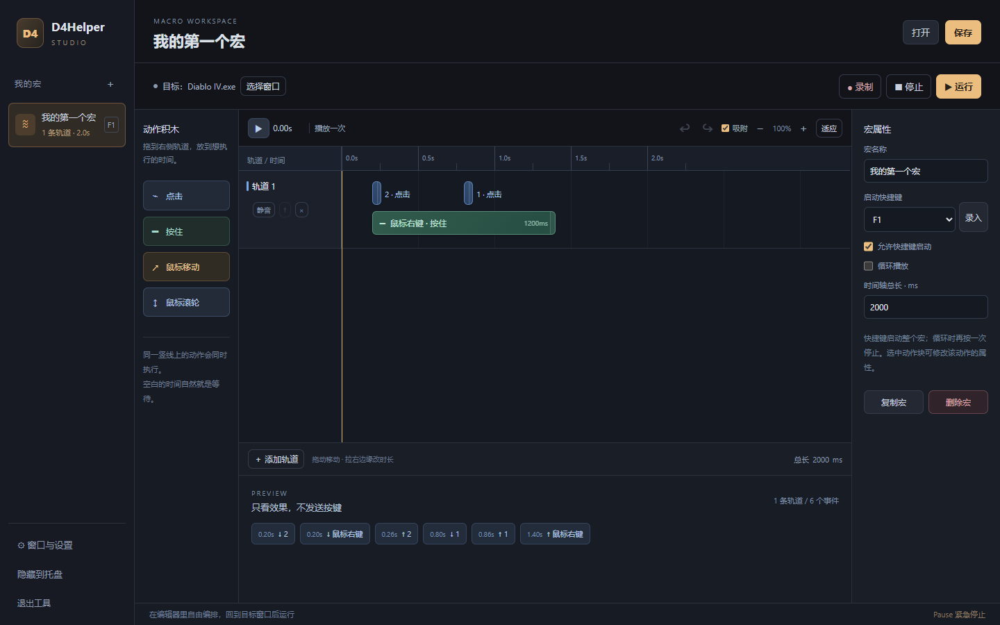

# D4Helper Studio

一个宏，一根时间尺，多条轨道。把键盘和鼠标动作拖进来，在同一段时间里编排。



## 三步开始

1. 运行 `dist/go/D4Helper.exe`，点击“选择窗口”，读取游戏窗口。
2. 从左侧拖入“点击、按住、鼠标移动、滚轮”。拖动动作块改变开始时间，拉右边缘改变时长。
3. 点击左侧宏，在右侧“宏属性”设置快捷键，保存。回到游戏按这个键，所有轨道一起播放。

同一竖线上的动作同时发生；空白的时间就是等待。需要持续重复时勾选“循环播放”，再按一次快捷键停止。`Pause` 紧急停止所有输入。

新版不再使用四槽、动作模式、一键启动组或录制回放模式。新建宏默认只有一条轨道，可按需添加。首次打开给出两轨示例：鼠标轨道按住右键，技能轨道在不同时间点击 2 和 1。

## 时间轴操作

- 拖入：把动作积木拖到任意轨道的任意时间，也可以点击积木添加到播放头位置。
- 移动：直接拖动作块，可跨轨道。
- 同轨顺序、跨轨并行：同一轨道内动作不能重叠，首尾相接可以。冲突落点显示红色，松手后取消放置，其他动作不挪动；瞬时动作在同轨同一毫秒也不能重叠。
- 时长：拉动作块右边缘；精确值在右侧属性修改，最小支持 1ms。
- 拉伸到下一个动作时自动停止；复制会寻找后面的空位。旧作品中的同轨重叠可点击“拆分到多条轨道”，保留原时间，保存后运行。
- 属性：点击左侧宏显示名称、快捷键、循环和自动计算的动作时长，标题右侧开关启用或停用整个宏；点击动作块只显示该动作的属性。
- 轨道：添加、改名、启用／关闭、上移／下移、确认删除。关闭后保留动作，播放时跳过该轨道。
- 时间轴导航：Shift＋滚轮横移；Ctrl＋滚轮以鼠标位置为中心缩放，也可使用顶部缩放按钮。
- 点击与按住：根据动作时长自动完成按下与释放，无需单独配置。
- 鼠标移动：指定起点、终点和时长；时长为 0 时直接移动。可用取点按钮读取屏幕坐标。
- 录制：在游戏窗口按 F12，录完再次按 F12。结果直接成为可编辑的多轨宏；连续鼠标移动合成一个轨迹块，缩放时长会调整速度。
- 时长：自动跟随所有轨道中最后一个动作结束，移动、缩短或删除动作后自动更新；画布留白只用于编辑。
- 循环：在“宏属性”中开启循环后，可设置“每轮结束后等待”，默认 0ms。末尾阴影区表示等待，下一轮在等待结束后开始。单个点击块只执行一次，需要多次点击时复制动作块。
- 空格：播放 / 暂停界面预览，不发送真实输入。
- Ctrl+Z / Ctrl+Shift+Z：撤销 / 重做；Ctrl+D：复制选中块；Delete：删除；Ctrl+S：保存。

真实“运行”按钮会等待 2 秒供你切回游戏。操作只在匹配的前台窗口生效，切出后停止并释放输入。关闭窗口隐藏到托盘，右键托盘可以停止或退出。

## 全新文件与执行模型

Studio 使用 `workspace.timeline.json`，格式版本 3。不会自动加载旧 `config.json` 或 `config.go.json`，也不把旧的一键启动映射进新作品。旧程序和配置保留在原位置。

编辑器只负责轨道与动作块；编译器合并所有轨道；Go 引擎仅执行带时间戳的原始输入事件。生产程序不依赖 Python 或 C++ DLL。

使用 Windows 高分辨率可等待定时器，空闲时阻塞。时间轴可以精确编辑到 1ms，但 Windows 与游戏本身仍会产生执行抖动。共享按键、部分发送失败恢复、失焦释放与注入事件过滤继续由执行层处理。

## 构建与测试

```powershell
.\build.ps1
.\dist\go\D4Helper.exe
```

需要 Go 1.23+ 和 WebView2 Runtime。构建脚本固定版本生成图标和 DPI manifest，无 Python / C++ 生产构建依赖。

```powershell
cd go-desktop
go test ./...
go vet ./...
npm ci --ignore-scripts
npm test
npm run test:browser
.\tools\smoke.ps1
```

浏览器测试用独立的无头 Edge 验证拖入、跨轨移动、拉伸、保存和截图；不会控制用户的浏览器。桌面启动自检强制无输入演练，通过真实 WebView 调用 Go 后端后退出。正常程序与旧版共用单实例锁；使用新版前请从托盘退出旧版。

## 当前范围

已经实现独立事件执行核心、多轨编译、可交互编辑器、鼠标移动 / 轨迹 / 滚轮、录制、托盘、状态浮层、原子保存与独立便携包。实际游戏识别率、长时间负载和多屏 DPI 仍需实测；自动化验证没有向游戏发送按键。隐藏到托盘保留 WebView。

设计说明见 [docs/studio-design.md](docs/studio-design.md)，模块说明见 [go-desktop/README.md](go-desktop/README.md)。旧 Python 说明保存在 [docs/legacy-python.md](docs/legacy-python.md)。MIT License。
